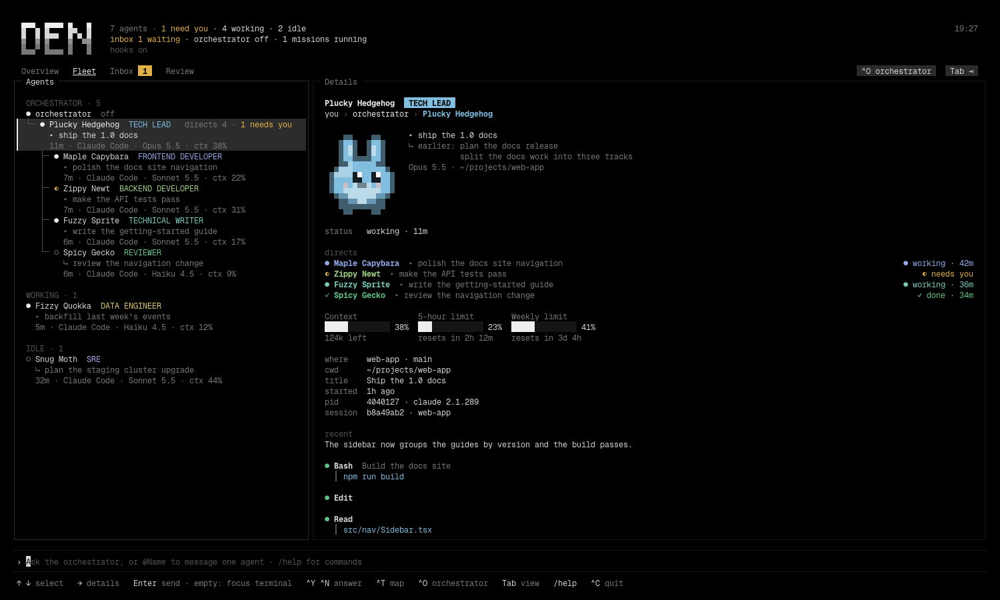
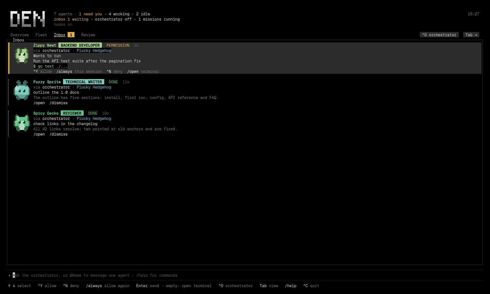

# Den

See, approve and steer all your Claude Code agents from one terminal screen.



Den is a small terminal UI that finds the Claude Code sessions already running
in your terminals, shows who they are (the agent-badge critter, role and task),
streams everything that needs your answer into one inbox, and lets you talk to
one agent with an `@mention` or to an orchestrator that speaks to all of them.
It also draws who directs whom, keeps standing goals as missions, and shows what
each agent changed as a diff you can comment on.

Den is Linux software. It reads `/proc` and `~/.claude/sessions`, brings
terminals to the front through Hyprland, and starts new ones through
`xdg-terminal-exec`. See [Requirements](#requirements) for what works without
Hyprland.

## Contents

- [Install](#install) · [Requirements](#requirements) · [On Omarchy](#on-omarchy) · [Quick start](#quick-start)
- [Views](#views): Overview, Fleet, Inbox, Review, Orchestrator
- [The command line](#the-command-line) · [Keys](#keys)
- [Orchestrator](#orchestrator) · [Dispatch cards](#dispatch-cards)
- [Who directs whom](#who-directs-whom) · [Spawning agents and teams](#spawning-agents-and-teams)
- [Overview, projects and missions](#overview-projects-and-missions)
- [Review](#review) · [The agent badge](#the-agent-badge)
- [Configuration](#configuration) · [Files Den writes](#files-den-writes)
- [Troubleshooting](#troubleshooting) · [Den, Herdr and OpenRig](#den-herdr-and-openrig) · [Contributing](#contributing) · [License](#license)

## Install

### From source

The repository uses a git submodule (`mods/agent-badge`, the agent-badge mod
that Den embeds in its binary). Clone with it, or the build has nothing to
embed:

```
git clone --recurse-submodules https://github.com/GlacierHubAB/den
cd den
# already cloned without it?  git submodule update --init
make build        # ./den, stamped with the version from git describe
make install      # builds into $PREFIX/bin/den, PREFIX defaults to ~/.local
```

`go install …/cmd/den@latest` does not work: the badge mod lives in the
submodule, which a Go module download does not include.

`make test` runs `go vet ./...` and the test suite against a scratch
`XDG_STATE_HOME`, so it never touches your own Den state.

### From a release

Tagged releases carry static Linux binaries, `den_linux_amd64` and
`den_linux_arm64`, and a `SHA256SUMS` file. Download the binary for your
machine and the checksum file into one folder, then:

```
sha256sum -c --ignore-missing SHA256SUMS
chmod +x den_linux_amd64
mkdir -p ~/.local/bin && mv den_linux_amd64 ~/.local/bin/den
den version
```

`make release` builds the same files into `dist/`; pushing a `v*` tag runs it
on GitHub Actions. Only Linux binaries are built.

## Requirements

- **Linux**, amd64 or arm64. Den reads the process tree from `/proc`
  (`internal/procs`), so it does not run on macOS or Windows.
- **Claude Code 2.1.289 or newer.** That is the version that writes
  `~/.claude/sessions/<pid>.json` for every live session, which Den treats as
  the source of truth (`internal/discover`). `claude` must be on `PATH` for the
  orchestrator and for spawned agents.
- **Go 1.26** (the `go` line in `go.mod`) to build from source.
- **A terminal** that reports `Shift+Enter` (Den asks for it; `Ctrl+J` and
  `Alt+Enter` also insert a newline). Thumbnails of pasted images need the kitty graphics protocol and
  are skipped without it.
- **Hyprland** for focusing an agent's terminal (`Enter` on an empty line,
  `den focus`) and for putting spawned terminals on your workspace. Without
  `hyprctl` the Fleet, Inbox, Review, orchestrator and hooks still work; focus
  reports that no window was found. herdr panes are
  focused too when the agent runs inside one.
- **A terminal launcher for spawning:** `uwsm-app` with `xdg-terminal-exec`,
  or `xdg-terminal-exec` alone, or `$TERMINAL`. Without one `spawn_agent` and
  `open_terminal` report an error (`internal/spawn/spawn.go`).
- **Hooks** (`den install-hooks`) for the inbox, permission answers, history
  and the hierarchy. Without them Den still lists and messages agents.
- **The agent-badge mod** (`den install-mods`) for roles, tasks and the 5-hour
  and weekly gauges. Optional: names and critters match with or without it.

## On Omarchy

Den is built on and for [Omarchy](https://omarchy.org), and that is where every
part of it works. On Omarchy:

- **Spawned agents open the way Omarchy opens a terminal.** Den runs
  `setsid uwsm-app -- xdg-terminal-exec --dir=<dir> -- claude …`, the same
  launch as Omarchy's terminal keybinding, so the window is your default
  terminal and is detached from Den (`internal/spawn/spawn.go`).
- **They land on the workspace you are on.** Den records the active Hyprland
  workspace before it launches and moves the new window there if it opened
  elsewhere (`internal/hypr`).
- **Enter focuses the agent's window** through `hyprctl`, matching Ghostty's
  one-process-many-windows by title and directory.
- **Colours follow the current Omarchy theme**, read from
  `~/.local/state/omarchy/current/theme/colors.toml` (`internal/theme`).

Install it the usual way: download a release binary into `~/.local/bin`
(already on Omarchy's `PATH`), or build it with `make install` (Go 1.26 or
later), then run `den install-hooks` once. Den ships no keybinding of its own;
to give it a key, bind `omarchy-launch-or-focus-tui den` in your Hyprland
bindings.

Other Linux desktops work too, without the window placement (see
[Requirements](#requirements)). Den does not run on macOS or Windows: it reads
`/proc`.

## Quick start

```
den install-hooks     # once; wires Den into ~/.claude/settings.json (backed up first)
den install-mods      # once; puts the bundled agent-badge mod into ~/.claude/skills
den                   # the TUI
```

Hooks and the mod apply to Claude Code sessions started after installing them.
Existing sessions show up in the Fleet at once but only report prompts and
turns once restarted.

`den install-hooks` adds one entry per event for `SessionStart`, `SessionEnd`,
`UserPromptSubmit`, `Notification`, `Stop`, `PostToolUse`, `PreToolUse`
(matcher `AskUserQuestion`) and `PermissionRequest`, each running `den hook`.
Installing twice replaces Den's old entries; `den uninstall-hooks` removes
them. `CLAUDE_CONFIG_DIR` moves the settings file Den edits.

### Commands

```
den                     the TUI
den list [-json]        what Den sees, for scripts and debugging
den focus mossy         focus an agent's terminal by name, session id or pid
den explain mossy       how Den arrived at that agent's name, status, window…
den send mossy "rebase on main first"   message an agent from a script
den ask "who is blocked on what?"       one orchestrator turn from a script
den events              headless: print hook events as they arrive
den install-hooks       wire Den into Claude Code's hooks
den uninstall-hooks     undo
den install-mods        put the bundled agent-badge mod into ~/.claude/skills
den mods                what ships in this binary and where it is loaded from
den uninstall-mods      undo
den config              the config file path and the settings in effect
den config init         write a documented ~/.config/den/config.toml
den version
```

`den mcp` and `den hook` are run by Claude Code, not by you.

## Views

The tab row reads `Overview  Fleet  Inbox  Review`. `Tab` and `Shift+Tab` cycle
through them. The orchestrator has no tab: `Ctrl+O` opens it and brings you
back, and sending plain text opens it too. Its state sits beside the keycap on
the tab row.

- **Overview**: one project at a time, its agents on the left and its missions
  on the right. See [Overview, projects and missions](#overview-projects-and-missions).
- **Fleet**: agents grouped by state (needs you, working, idle, gone) or by the
  tree that directs them, each with critter, role, task, repo, branch and
  context usage. A details pane shows the selected agent's animated critter,
  context and usage gauges, the chain of command and recent activity. `Enter`
  on an empty line brings that agent's terminal to the front.
- **Inbox**: every permission request, plan review, question and finished turn
  from every session. See below.
- **Review**: what each agent changed, as a diff. See [Review](#review).
- **Orchestrator**: the chat with the agent that knows the fleet.

### Inbox



With the hooks installed, each item is a permission, a plan review, a question
or a finished turn. Waiting permissions and plans can be answered from Den:
`Ctrl+Y` allows and `Ctrl+N` denies the waiting one, `/always` allows it and
the same tool again this session, `/open` focuses the terminal, `/dismiss`
clears an item. Finished turns are appended to
`~/.local/state/den/history.jsonl` (the newest `inbox.history`, 100 by default,
come back on restart). The request shows the whole command or edit the
permission is about.

Den holds a permission request only while you are not at that terminal. If the
agent's window is focused, or you switch to it, the normal Claude Code dialog
appears instead, and so it does when `hooks.permission_wait` (580 s) runs out
or Den is not running.

Messages you send to an agent arrive in its session the way messages from other
Claude Code sessions do, with a first line saying they come from you via Den.
While you are at that agent's terminal Den holds the message and delivers it
when you leave, so it never lands under something you are typing.

## The command line

The line at the bottom is always open. Type to ask the orchestrator, `@Name …`
to message one agent (`Tab` completes the name), `/help` for commands. It grows
with what you type, one row for a short message and up to eight as text wraps
or you add line breaks, then scrolls; the panes above shrink to make room.

Images travel with a message. Paste or drag an image file (a path, a `file://`
URL or several lines of them) and it becomes a chip, `[Image #1]`, in the text;
`Ctrl+V` takes an image straight from the clipboard (saved under
`~/.local/state/den/attachments/`). When the message goes out the chip reads
`[Image #1: /full/path.png]`, so the receiving session can open the file. If
the terminal answers Den's kitty-graphics query, a thumbnail is drawn next to
each chip. Delete a chip from the text and its image is left out.

### Slash commands

| Command | Does |
| --- | --- |
| `/allow` `/y`, `/deny` `/n`, `/always` `/a` | answer the waiting prompt |
| `/open` `/o` `/focus` | focus the selected agent's terminal |
| `/dismiss` `/x` | clear the selected inbox item |
| `/rescan` `/r` | refresh now (in Review, reload the diffs) |
| `/overview` `/missions`, `/fleet`, `/inbox`, `/review` | switch view |
| `/map` | toggle the Fleet map |
| `/orchestrator` `/orch` | open the orchestrator; `/orch new` starts a fresh session, `/orch restart` restarts it |
| `/project <name>`, `/project add <dir>`, `/project drop` | pick, list or unlist a project |
| `/mission <goal>`, `/pause`, `/resume`, `/stop` | missions |
| `/delete` `/del` | remove the review comment under the cursor |
| `/help` `/?`, `/quit` `/q` `/exit` | |

## Keys

| Key | Does |
| --- | --- |
| `Tab` / `Shift+Tab` | next / previous view (with `@` typed, `Tab` completes the name) |
| `Ctrl+O` | open the orchestrator, press again to go back |
| `← →` | move between panes; on Overview switch project; in Fleet fold and unfold a branch |
| `↑ ↓` | select, or scroll in the focused pane |
| `PgUp PgDn` | scroll the chat; half a screen in Review; five rows elsewhere |
| `Enter` | send; with an empty line, focus the selected agent's terminal (Overview: open the mission; chat: expand the card; Review: edit the comment under the cursor) |
| `Shift+Enter`, `Alt+Enter`, `Ctrl+J` | newline |
| `Ctrl+Y` / `Ctrl+N` | allow / deny the waiting prompt (Overview: start / drop the proposed mission) |
| `Ctrl+T` | toggle the Fleet map |
| `Ctrl+V` | paste an image from the clipboard |
| `Esc` | clear the line; closes a proposal or an open mission; drops a review edit or range |
| `Ctrl+C` | quit |

Review adds `Shift+↑ ↓` to extend a selection and mouse support: click a work,
file or line, drag or shift-click for a range, wheel to scroll. The mouse is
only captured on that tab, so other views keep the terminal's own selection.

## Orchestrator

The orchestrator is a headless Claude Code session Den starts on your first
plain-text message. It has four tools: `ListAgents` and `SendMessage`, plus two
Den gives it through its own MCP server (`den mcp`), `spawn_agent` and
`open_terminal`. It gets a fresh roster of the fleet with every message, so it
can answer "who is blocked on what?" or relay "tell Mossy to rebase first". It
cannot approve anything; you do that in the inbox.

Its turns are billed like any other session. It uses `sonnet` unless the config
file or `DEN_ORCHESTRATOR_MODEL` says otherwise (`"off"` keeps Claude Code's
default). Only Den's MCP server is loaded into it (`--strict-mcp-config`); your
own MCP servers never are. A watchdog names a silent turn, restarts it once and
resends what it owes.

The chat persists: every entry and card state is appended to
`~/.local/state/den/orchestrator.jsonl` and restored on launch (newest 500).
The orchestrator resumes its previous session; if that fails, Den starts a fresh
one and replays the last exchanges.

### Dispatch cards

When the orchestrator hands a brief to an agent, that agent's turn shows up in
the chat as a card the agent owns: its avatar and colour, the role chip, the
brief, and a state chip through queued, working, needs you, done or failed.
While it works the card shows the latest tool call from the hook stream; done,
it collapses to the agent's last message in one sentence with call and file
counts. With two or more cards live, a strip at the top of the pane keeps them
in view. Everything on a card comes from the agent's own hooks and transcript,
never from the orchestrator's retelling.

| Key | On a focused card |
| --- | --- |
| `↑ ↓` | move between cards; past the last one the chat follows its tail again |
| `Enter` (empty line) | expand to the agent's full turn, with diffs and output |
| `→` | open the agent in the Fleet; `←` comes back to the card |
| `Ctrl+Y` `Ctrl+N` | answer the card's permission, exactly as in the inbox |
| `/open` | focus the agent's terminal |

## Who directs whom

Agents hand work to each other over Claude Code's session messaging, so the
fleet is a tree, not a list. Den learns the edges from traffic it already sees:
a dispatch card is an edge from the orchestrator; a peer message arriving at an
agent (the `UserPromptSubmit` hook carries the sender) puts the receiver under
the sender, unless the receiver sits above the sender, in which case it is a
report back; an agent the orchestrator spawned is its child from the start.
Edges are appended to `~/.local/state/den/edges.jsonl` and come back on
restart; a child keeps its newest parent and drops out of the tree when its
session is gone.

In the Fleet every tree sits in its own section, the orchestrator's first, with
guides between parent and child, `directs n` on a parent and what the branch
needs rolled up (`1 needs you`). `←` folds the selected branch and `→` unfolds
it. The details pane shows the chain of command (`you › orchestrator › Mossy
Lemur`) and a `directs` list with each child's brief and state. `Ctrl+T` or
`/map` swaps the pane for a map: one column per level from you to the leaves;
`↑ ↓` walk it, `←` goes to the parent and `→` to the first child.

In the chat, a card whose agent handed work on grows a line per child, and its
state says `needs you · via <child>` when something deeper down is waiting on
you; `Ctrl+Y` / `Ctrl+N` on it answer the child's request. Inbox items from an
agent inside a tree carry a `via orchestrator › …` line.

## Spawning agents and teams

Ask the orchestrator for a new agent ("start an agent in ~/code/site that fixes
the login redirect") and it opens your default terminal in that directory with
`claude --name <peer>` running and its brief as the first prompt. The brief
arrives introduced as coming from the orchestrator on your behalf and asks the
agent to report back when done or blocked. The agent appears in the Fleet like
any other, and the orchestrator tells you its critter name. "Open a terminal in
~/code/site" gives you a plain shell the same way.

The terminal is launched the way Omarchy's own keybinding does it (`setsid
uwsm-app -- xdg-terminal-exec --dir=…`), so it is detached from Den. Den records
your active workspace first and moves the new window there if it landed
elsewhere. If Claude Code has never worked in the folder, it asks you to trust
it in that terminal first; nothing happens until you answer. Set `spawn =
false` under `[orchestrator]`, or `DEN_ORCHESTRATOR_SPAWN=off`, to take the two
tools away.

**A model per agent.** `spawn_agent` takes a model: `haiku` for small,
mechanical, well-specified tasks, `sonnet` for ordinary building, writing and
fixing, `opus` for work that needs judgment (design, architecture, review,
leading others). The orchestrator picks by the task. Its spawn note says which
(`▶ starting an agent in ~/code/site on opus · …`), and once the session
registers the note becomes that agent's dispatch card.

**Leads staff their own work.** Every agent the orchestrator starts gets Den's
MCP server too, so it has `spawn_agent` itself, pre-approved. A lead's brief
names the roles under it with their models and parts; it starts them in their
own terminals, they report to the lead, and the lead reports up when the piece
is done. Ask for "a team" and the orchestrator starts one lead on `opus` and
leaves the rest to it. Den learns each of those spawns from the lead's own hook
stream (`PostToolUse` on `spawn_agent`), so the Fleet draws the tree as it
grows, and the lead's card stays `working · waiting on 3 agents` between turns
until nobody under it is at work.

## Overview, projects and missions

The Overview tab, first in the row, shows one project at a time. Projects are
the repositories agents work in, found through the files their transcripts say
they edited plus session folders that are checkouts; the strip under the tabs
lists them with a count of agents on each. `← →` or `/project <name>` switch,
the pick is remembered, and the Review tab follows it. A folder nobody works in
yet is listed with `/project add <dir>` (its repository root when it is inside
one) and stays listed, empty, until `/project drop`.

A mission is a standing goal: a purpose in one sentence, constraints that ride
on every dispatch, and what done looks like, or "standing" for one that never
ends. Type the goal on the Overview command line (or `/mission <goal>`) and the
orchestrator answers with a proposal: the mission rewritten, done-when,
constraints it inferred, the agents it means to reuse, the team it means to
start (roles as a tree, each with the model it picked), and the shape it chose
with one line of reasoning. `Ctrl+Y` starts it, `Ctrl+N` drops it, typing
refines it, `Esc` keeps it for later. Nothing runs before `Ctrl+Y`. When the
run starts, the orchestrator spawns only the roles that report to it; each lead
starts its own people.

| Shape | Runs as |
| --- | --- |
| `▶ once` | one dispatch to one agent; done when it reports back |
| `↻ loop` | one agent iterates; after each pass Den asks the orchestrator whether the goal is met, and it re-dispatches until it is |
| `⇶ fan-out` | a lead with children in parallel, repeated until the lead says done |
| `⏲ schedule` | Den fires a run on the cadence (`every 30m`, `daily 08:30`, `weekly mon 09:00`, or a five-field cron line); each run is a once or a fan-out |

Den drives the runs: it asks the orchestrator to dispatch, tags the resulting
cards with the mission, notices when they settle, and asks again when the shape
calls for another pass. `Enter` on a mission opens it: the fields, then its
runs with the same dispatch cards the chat shows. `/pause` holds the next run,
`/resume` lets it go, `/stop` ends the mission and keeps its history. Missions
persist in `~/.local/state/den/missions.jsonl`; the project pick and pinned
projects in `overview.json` beside it.

## Review

The Review tab shows what each agent changed, as git sees it on disk, with
every changed line coloured by the session that wrote it. It follows the
project picked on Overview.

- **Which files.** From each agent's transcript (its Edit, Write and Bash file
  changes), not from the folder it started in, so an agent started in `~` that
  edits files in several repositories is covered.
- **Which diff.** The working tree against a base: committed, staged and
  unstaged changes, and untracked files that are not ignored. On a feature
  branch the base is where it left the default branch (origin's HEAD, else
  `main` or `master`); on the default branch itself it is the last commit
  before the session started, so work committed straight to main still shows.
- **Per agent, per line.** Each agent gets the files in which it owns at least
  one changed line, with its own added and removed counts. A line belongs to
  the newest agent edit that added (or removed) exactly that text. Lines no
  edit explains stay grey. Two agents in one file are told apart line by line.
- **Syntax highlighting.** Code in the diff is coloured with
  [chroma](https://github.com/alecthomas/chroma), the lexer picked from the
  file name. Each hunk is lexed as the new side and the old side so block
  comments and strings that span lines colour correctly. Changed lines sit on a
  faint green or red tint. Files chroma does not know, and diffs over 256 KB,
  are drawn plain.
- **Comments.** Select a line (`Shift+↑ ↓` or the mouse for a range), type, and
  `Enter` saves a draft comment addressed to the agent that wrote most of those
  lines. `Enter` on an empty line edits the comment under the cursor and
  `/delete` removes it. Drafts are kept in `~/.local/state/den/reviews.json`
  (readable only by you) and survive restarts. **Sending comments back to the
  agent is not implemented yet**; they are drafts you can read in Den.
- **Refresh.** The diffs reload when you enter the tab if they are older than
  2 s, every 15 s while it is open, and on `/rescan`.

Left column: **Recent work**, one entry per agent, and **Files** for the
selected work. Centre: the diff. On wide terminals a right column lists the
drafts by recipient. Narrower than 72 columns the diff is shown alone.

## The agent badge

[agent-badge](https://github.com/GlacierHubAB/agent-badge) is a Claude Code
mod, MIT licensed, that pins a band above each session's prompt with the
agent's name, critter, role, current and earlier tasks, and gauges for context,
the 5-hour and weekly limits. It is a git submodule at `mods/agent-badge` and is
embedded in the Den binary; `den install-mods` copies it to `~/.claude/skills`,
which Claude Code loads without further setup. If a development checkout is
already loaded through `CLAUDE_CODE_PLUGIN_DIRS` the installer says so and
leaves it alone (`--force` installs anyway). Claude Code 2.1.289+ is needed.
Role and task come from a small Haiku call through your own Claude Code session,
billed like any other usage.

The critter name and face are seeded from the session id, so a resumed session
keeps them. Den computes the same names and sprites itself (a port of the
badge's generator in `internal/badge`), so they match with or without the badge;
the badge adds roles, tasks and the gauges (1.1.0+).

Colours follow the current Omarchy theme. Only the theme's real hues are used
for agents, topped up from a built-in set of twelve soft colours to at least ten.
Den gives every live session its own colour, oldest session first, and records
the choice in `~/.local/state/den/colors.json`; the badge (1.2.0+) reads that
file so the critter in each terminal matches the one in Den. The same colour
marks the agent in the Fleet, inbox, dispatch cards, the map and Review.

## Configuration

Everything has a default, so the file is optional. `den config init` writes
this starting point to `~/.config/den/config.toml` (`$XDG_CONFIG_HOME/den/` when
set; `DEN_CONFIG` overrides the path):

```toml
[orchestrator]
model = "sonnet"            # any claude --model value, or "off" for Claude Code's default
name = "den-orchestrator"   # how the orchestrator session names itself to peers
spawn = true                # may open terminals and start agents on the workspace you are on

[inbox]
history = 100               # finished turns kept as history

[detail]
recent = 20                 # activity entries shown in the details pane

[hooks]
permission_wait = 580       # seconds Den may hold a permission before the terminal dialog takes over
log = true                  # append every hook run to ~/.local/state/den/hooks.log
```

`DEN_ORCHESTRATOR_MODEL`, `DEN_ORCHESTRATOR_SPAWN=off`, `DEN_PERMISSION_WAIT`
and `DEN_HOOK_LOG=off` win over the file. `DEN_SOCKET` moves the socket the
hooks talk to (default `$XDG_RUNTIME_DIR/den.sock`).

## Files Den writes

State lives under `$XDG_STATE_HOME/den/` (`~/.local/state/den/` by default):

| File | Holds |
| --- | --- |
| `hooks.log` | one line per hook run: event, session, delivered or not |
| `history.jsonl` | finished turns |
| `orchestrator.jsonl` | the orchestrator chat and card states |
| `edges.jsonl` | who directs whom |
| `missions.jsonl` | missions and their runs |
| `overview.json` | the picked and pinned projects |
| `reviews.json` | Review comments |
| `colors.json` | the colour of each session |
| `attachments/` | images pasted from the clipboard |

Den also edits `~/.claude/settings.json` (hooks, with a backup beside it) and
`~/.claude/skills` (the badge mod), and listens on a Unix socket in
`$XDG_RUNTIME_DIR`. It reads `~/.claude/sessions/` and Claude Code's transcripts
under `~/.claude/projects/`; it does not write to those two.

## Troubleshooting

- **No agents listed.** Den needs Claude Code 2.1.289+; older versions do not
  write `~/.claude/sessions`. Press `/rescan`, or run `den list` to see what
  Den sees and `den explain <name>` for how it arrived at a name or status.
- **Nothing reaches the inbox.** Hooks apply to sessions started after
  `den install-hooks`. Check `~/.local/state/den/hooks.log`; a line ending in
  `no den listening` means the hook ran but Den was not running.
- **Enter does not focus a terminal.** Focus needs Hyprland (`hyprctl`) and
  finds the window by title or working directory; `den explain <name>` says how
  it matched, or why not.
- **Spawn fails.** Install `xdg-terminal-exec` or set `$TERMINAL`; `claude`
  must be on `PATH`.
- **Orchestrator costs.** It is a real Claude Code session; lower the cost with
  `model = "haiku"` or turn spawning off.

## Den, Herdr and OpenRig

[Herdr](https://github.com/herdrdev/herdr) and
[OpenRig](https://github.com/mvschwarz/openrig) are open-source tools for running
many coding agents too. They solve different parts of the problem, and Den can
sit next to Herdr rather than replace it.

| | Den | Herdr | OpenRig |
| --- | --- | --- | --- |
| What it is | A dashboard and control room for the Claude Code sessions already running on your machine | A terminal multiplexer for agents: it owns their terminals in a background server | A daemon that runs agent teams defined in YAML, on tmux |
| Agents | Claude Code | Claude Code, Codex, Cursor, OpenCode and others | Claude Code, Codex and Pi |
| Where agents run | In your own terminal windows; Den reads `~/.claude/sessions` | In Herdr's panes; detach and reattach, also over SSH | In tmux sessions OpenRig starts, or Herdr when installed |
| Platforms | Linux (Omarchy/Hyprland for window placement) | Linux, macOS, Windows | macOS, Linux, WSL2 |
| License | MIT | Apache-2.0 | Apache-2.0 |

What Den does that is its own:

- **One approval inbox.** Permission requests, plan reviews, questions and
  finished turns from every session land in one list; `^Y` / `^N` answer a
  waiting permission or plan without switching windows.
- **An orchestrator you talk to,** a Claude Code session that can message,
  spawn and staff agents for you. (OpenRig also lets you talk to a lead agent.)
- **Missions:** standing goals run once, in a loop, fanned out or on a schedule.
- **Who directs whom,** drawn as a tree from the messages agents send each other.
- **Review:** every agent's changes as a highlighted diff, each line in the
  colour of the agent that wrote it, with comments kept as drafts.
- **The agent badge:** a name, critter, role and task for each session.

Where the others go further: Herdr keeps agents alive when you close the
client or lose SSH, works across several machines, supports many agent CLIs and
runs on macOS and Windows. OpenRig gives agent teams persistent roles,
addresses and a work queue, and runs Claude Code and Codex side by side.

Den works with Herdr: it notices a Claude Code session running inside a Herdr
pane and, on focus, asks Herdr to bring that pane forward
(`internal/fleet/fleet.go`). Herdr and OpenRig are their authors' projects;
the descriptions above come from their READMEs as of October 2026.

## Contributing

See [CONTRIBUTING.md](CONTRIBUTING.md) and [docs/DEVELOPMENT.md](docs/DEVELOPMENT.md).

## License

MIT, see [LICENSE](LICENSE). The bundled agent-badge mod
(`mods/agent-badge`) is MIT licensed under its own `LICENSE`, and Den's name
generator in `internal/badge` is ported from it.
